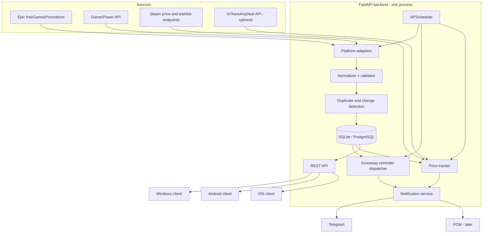
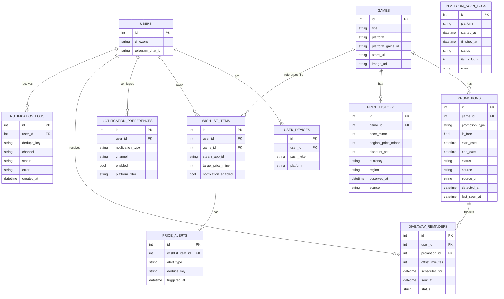

# Free Game Radar — Phase 0: Planning & Feasibility Assessment

> Status: **Planning only. No application code.** Waiting for approval before Phase 1.
> Date: 17 November 2026

## 0. How to read this document

Every feasibility claim is tagged with its evidence level:

- **[V]** Verified in this session against a source listed in section 17.
- **[K]** From my background knowledge, not re-checked this session. **Must be re-verified in Phase 1/3 before code depends on it.**
- **[U]** Unknown or not found. Treated as unsupported until proven.

Where I could not verify something, I say so instead of guessing.

---

## 1. Final MVP scope (one developer)

### Must have (MVP)

1. Giveaway monitoring for **Epic, Steam, GOG** (Steam and GOG via the aggregator fallback, see section 10).
2. Normalized promotions, duplicate and change detection, expiry handling.
3. Countdown using the real `end_date`, or "End date unknown".
4. Reminders at 24h, 6h, 1h, 30min (configurable), persisted in the DB, idempotent.
5. Telegram notifications.
6. Steam wishlist: manual App ID/URL entry, public wishlist import where permitted.
7. Steam price tracking in IDR/Indonesia with internal price history ("Recorded Lowest").
8. Target price alerts.
9. REST API, health check, tests, Docker, CI, README.
10. One Flutter client: **Windows desktop + Android** first.

### Should have (after MVP works)

- External historical low via IsThereAnyDeal (needs API key).
- iOS client and push via FCM/APNs.
- Ubisoft and EA promotions via aggregator (partial support, clearly labeled).
- Multi-user accounts.

### Won't have (v1)

- Rockstar support (no source found, section 10).
- Any login to store accounts, auto-claiming of games, scraping behind authentication.
- Currency conversion.

### Key simplification to approve

**MVP is single-user and self-hosted.** One owner, one bot, one API token. The schema keeps a `users` table so multi-user can be added later, but I will not build registration, OAuth or per-user authorization in v1. This removes the largest security and scope risk. Your master prompt itself warns against multi-user without auth, so this is consistent with it.

---

## 2. Functional requirements (condensed)

| ID | Requirement | Phase |
|---|---|---|
| F1 | Each platform scanned by an independent adapter; one failure never blocks others | 3 |
| F2 | Normalize to a common model; classify promotion type (never assume free = keep) | 3-4 |
| F3 | Detect NEW / UPDATED / UNCHANGED / EXPIRED | 4 |
| F4 | Store UTC, display in user timezone (default Asia/Jakarta) | 2 |
| F5 | Reminders survive restart, never duplicate, stop at expiry, reschedule if end date changes | 4-6 |
| F6 | Steam wishlist add/remove/import with honest private-profile errors | 4 |
| F7 | Price history with source, currency, region, timestamp | 4 |
| F8 | Alerts: discount, further drop, recorded low, external low, target price | 6 |
| F9 | Per-type and per-platform notification preferences, history, delivery logs, bounded retries | 6 |
| F10 | REST API with Pydantic schemas, pagination, filtering, consistent errors | 7 |

## 3. Non-functional requirements

- **Reliability:** per-adapter timeouts, bounded retries with backoff, scan logs in DB.
- **Politeness:** one request per source per scan where possible, conditional caching, never hammer endpoints.
- **Idempotency:** unique constraints, not in-memory flags, guarantee no duplicate notifications.
- **Honesty:** unsupported sources are labeled in `/api/platforms`; unknown end dates are shown as unknown.
- **Security:** no store passwords, secrets only in env, `.env.example` placeholders.
- **Testability:** adapters tested against saved fixture responses, no live network in CI.
- **Maintainability:** simple layered design, no microservices.

---

## 3.5 Decisions needing your approval

| # | Decision | My recommendation |
|---|---|---|
| D1 | Single-user MVP | Yes |
| D2 | Giveaway sources | Epic direct, others via GamerPower, labeled as third-party |
| D3 | Client framework | Flutter |
| D4 | Push | Telegram first, then FCM for both Android and iOS |
| D5 | Database | SQLite for MVP, PostgreSQL via the same SQLAlchemy models |
| D6 | Rockstar | Unsupported in v1 |

---

## 4. System architecture



## 5. Component architecture

- **adapters/**: one class per source implementing `fetch() -> list[RawPromotion]`. No DB access.
- **services/**: normalization, `PromotionService` (dedupe, change detection, expiry), `ReminderService`, `WishlistService`, `PriceService`.
- **repositories/**: all SQLAlchemy queries. Services never build queries inline.
- **notifications/**: `NotificationChannel` interface, `TelegramChannel`, later `FcmChannel`. A dispatcher applies preferences, dedupe key, cooldown, and retry.
- **scheduler/**: job definitions only; jobs call services.
- **api/**: routers, Pydantic schemas, dependency injection. No business logic.

Dependency direction: `api → services → repositories/adapters`. Adapters never import services.

## 6. Proposed folder structure

```text
free-game-radar/
├── backend/
│   └── app/
│       ├── api/            # routers, deps, error handlers
│       ├── adapters/       # base.py, epic.py, gamerpower.py, steam_price.py, steam_wishlist.py
│       ├── services/
│       ├── repositories/
│       ├── models/         # SQLAlchemy
│       ├── schemas/        # Pydantic
│       ├── notifications/
│       ├── scheduler/
│       ├── core/           # config, logging, time utils
│       └── main.py
│   ├── migrations/         # Alembic
│   └── tests/
│       ├── fixtures/       # saved real responses, redacted
│       └── ...
├── frontend/               # Flutter app (Phase 10 only)
├── docs/                   # this plan, data-sources.md, architecture.md
├── .github/workflows/ci.yml
├── Dockerfile
├── docker-compose.yml
├── .env.example
├── pyproject.toml
├── README.md  LICENSE  CONTRIBUTING.md
```

Slight deviation from your sample tree: backend code lives under `backend/app/` with tests inside `backend/tests/`, which keeps Python packaging simple. No empty folders are created until needed.

---

## 7. Database design

Final tables for the MVP. Three suggested tables are merged or deferred and explained below.



Design notes:

- **Money as integer minor units + currency** (e.g. IDR has no decimals in Steam's price_overview; USD cents). Never floats. Never compare across currency/region.
- **`games` unique on `(platform, platform_game_id)`**; this is the duplicate-detection backbone. Cross-store title matching is explicitly out of scope for v1 (a game can legitimately exist on Steam and Epic).
- **`promotions` unique on `(game_id, promotion_type, start_date, source)`**; end_date changes update the row and trigger reminder rescheduling.
- **`giveaway_reminders` unique on `(user_id, promotion_id, offset_minutes)`**; sending flips `status` `PENDING→SENT` inside a transaction, which makes dispatch idempotent and restart-safe.
- **`price_alerts.dedupe_key`** (e.g. `appid:price_minor:alert_type`) with a unique constraint prevents repeat alerts for the same price.
- **Merged/deferred:** `wishlists` is merged into `wishlist_items` (one wishlist per user in v1). `price_alerts` stores only fired alert state; the target price lives on `wishlist_items`, avoiding a second source of truth for the same value.
- Alembic migrations from day one. SQLite needs batch mode for some ALTERs; noted as a risk.

---

## 8. REST API plan

All under an API-token dependency in MVP. Pagination via `limit`/`offset`; errors as `{ "error": { "code", "message" } }`.

| Method | Path | Purpose |
|---|---|---|
| GET | `/health` | Liveness + DB check (no auth) |
| GET | `/api/status` | Last successful scan per platform, scheduler state |
| GET | `/api/platforms` | Platform list with support status (SUPPORTED / PARTIAL / UNSUPPORTED) |
| GET | `/api/games` | List games, filters: platform, promotion_type, is_free |
| GET | `/api/games/free` | Active free promotions with `end_date` (nullable) |
| GET | `/api/games/{id}` | Game + promotions |
| GET | `/api/games/platform/{platform}` | Filtered list |
| GET | `/api/wishlist` | Items with current price |
| POST | `/api/wishlist` | Body: `steam_app_id` or `store_url`, optional `target_price` |
| POST | `/api/wishlist/import` | Body: SteamID/profile URL; returns clear error if private |
| DELETE | `/api/wishlist/{id}` | Remove |
| GET | `/api/wishlist/{id}/price-history` | History + recorded low + external low (labeled) |
| GET/POST/PUT | `/api/price-alerts[/{id}]` | Target price management |
| GET | `/api/reminders` | Scheduled and sent reminders |
| GET | `/api/notifications` | Delivery history |
| GET/PUT | `/api/notification-preferences` | Per type/channel/platform |
| POST/DELETE | `/api/devices` | Push token registration (Phase 10) |

## 9. Notification architecture

- `NotificationEvent(type, user, payload, dedupe_key)` → `NotificationDispatcher`:
  1. Check preference for type/platform/channel.
  2. Check `notification_logs` for the dedupe key and cooldown.
  3. Send via channel; write log row (`SENT`/`FAILED`, error text).
  4. Failed sends retried by a job with a **max attempts** cap and backoff.
- **Telegram** is the MVP channel. It reaches phone and desktop with no Apple/Google setup, which is why it comes first.
- **Push:** use **Firebase Cloud Messaging for both Android and iOS** (FCM can deliver to iOS through an APNs key uploaded to Firebase **[K]**), instead of building a separate direct-APNs path. iOS still requires a Mac, an Apple Developer account and a real device to test **[K]**. No push claim is made until tested on hardware.
- **Windows:** local notifications only fire while the app runs. For guaranteed reminders when the app is closed, Telegram is the answer. This must be documented honestly.

## 10. Platform adapter architecture

```python
class PlatformAdapter(Protocol):
    platform: str
    support_status: SupportStatus   # SUPPORTED | PARTIAL | UNSUPPORTED
    async def fetch(self) -> list[RawPromotion]: ...
```

- The scan job runs each adapter in its own `try/except` with a timeout; result goes to `platform_scan_logs`.
- Raw responses are validated by Pydantic; invalid items are dropped and counted, not stored.
- External URLs are checked against an allow-list of store domains before being saved as `store_url`.
- Fixture-based tests per adapter.

## 11. Scheduler architecture

- APScheduler in-process, `max_instances=1` and `coalesce=True` per job to prevent overlap.
- Jobs: `giveaway_scan` (30 min), `expire_check` (5 min), `reminder_dispatch` (**every 1 min**, DB-driven), `wishlist_sync` (daily), `price_scan` (start at 6h, tune after reading limits), `notification_retry` (5 min).
- **Reminders are rows, not scheduler jobs.** The dispatcher queries `PENDING` reminders with `scheduled_for <= now` and an unexpired promotion. After a restart it simply continues, and missed reminders inside the grace window are still sent once; reminders for expired promotions are marked `SKIPPED`.
- When a scan changes an `end_date`, pending reminders for that promotion are recomputed.
- Multi-worker deployment would duplicate jobs; MVP runs a single process (documented limitation).

## 12. Environment variable plan

```env
APP_ENV=development
DATABASE_URL=sqlite:///./data/fgr.db
API_TOKEN=change-me
DEFAULT_TIMEZONE=Asia/Jakarta
STEAM_REGION=ID
STEAM_CURRENCY=IDR
GIVEAWAY_SCAN_INTERVAL_MINUTES=30
PRICE_SCAN_INTERVAL_MINUTES=360
WISHLIST_SYNC_INTERVAL_MINUTES=1440
REMINDER_OFFSETS_MINUTES=1440,360,60,30
STEAM_WEB_API_KEY=
TELEGRAM_BOT_TOKEN=
TELEGRAM_CHAT_ID=
ITAD_API_KEY=
FCM_CREDENTIALS_PATH=
HTTP_TIMEOUT_SECONDS=15
USER_AGENT=FreeGameRadar/0.1 (contact: you@example.com)
```

Placeholders only in `.env.example`; real `.env` git-ignored.

## 13. Dependencies (with reasons)

| Package | Reason |
|---|---|
| fastapi, uvicorn | API + OpenAPI docs |
| pydantic v2, pydantic-settings | Schemas and config validation |
| sqlalchemy 2, alembic | ORM and migrations |
| httpx | Async HTTP with timeouts |
| apscheduler | Scheduling (see section 11) |
| tenacity (optional) | Bounded retry/backoff; can be hand-rolled to save a dependency |
| pytest, pytest-asyncio, respx | Tests with mocked HTTP |
| ruff, mypy | Lint and typing in CI |
| firebase-admin (Phase 10 only) | FCM sending |

**Not included:** BeautifulSoup (no HTML parsing needed so far), Celery/Redis (overkill), a Telegram library (a plain HTTPX call to the Bot API is enough).

---

## 14. Platform feasibility matrix

Legend: Feasible now / Partial / Unsupported.

| Source | Access method | Official? | Auth | Verdict | Evidence |
|---|---|---|---|---|---|
| **Epic giveaways** | `store-site-backend-static.ak.epicgames.com/freeGamesPromotions?locale=&country=`; `promotionalOffers` = free now, `upcomingPromotionalOffers` = upcoming; start/end dates are UTC ISO 8601 | **No.** Public but undocumented; widely reused by community projects | None | **Feasible now**, with schema-drift risk | **[V]** |
| **GamerPower (aggregator)** | `https://www.gamerpower.com/api/giveaways?platform=…` and `/filter`; covers steam, epic, gog, ubisoft, origin, etc.; no auth; **attribution required** | Official API of a third party, not of the stores | None | **Feasible now** as the source for Steam, GOG; **Partial** for Ubisoft and EA (third-party curation, accuracy depends on them) | **[V]**; rate limits, `end_date` field format and reliability **[K]**, check in Phase 3 |
| **Steam giveaways / free-to-keep** | No official promotion feed found. Options: GamerPower; Steam store search filtered to 100% discount (**[K]**, unverified) | No | None | **Partial** (via aggregator); distinguishing free-to-keep vs free weekend must come from the offer text, flag `UNKNOWN` when unsure | **[U]** for a first-party source |
| **GOG giveaways** | GamerPower; GOG's catalog endpoint (`catalog.gog.com`) exists and is used by community projects; `api.gog.com/products/*` has a reported 200 req/hour/IP limit, and its price endpoint is reported unreliable | No official public API docs | None | **Partial** (aggregator-first; direct GOG parsing only if needed) | **[V]** for existence and the limit (community forum posts, not GOG documentation) |
| **Ubisoft Connect** | Only via GamerPower (platform `ubisoft`) | No first-party source found | None | **Partial** via aggregator, else **Unsupported** | **[V]** aggregator covers it; **[U]** first-party |
| **EA app** | Only via GamerPower (platform `origin`, which is the legacy label) | No first-party source found | None | **Partial** via aggregator | **[V]** same |
| **Rockstar** | Nothing found; GamerPower platform list in the spec I read does not include it | None found | n/a | **Unsupported** in v1 | **[V]** absent from the spec; **[U]** otherwise |
| **Steam wishlist** | `IWishlistService/GetWishlist/v1/?steamid=` on `api.steampowered.com`; returns data only for **public** profiles; the community-maintained API reference lists it, but it is not in Valve's official docs | Undocumented by Valve | SteamID; a Web API key may be needed **[K]** | **Feasible** for public wishlists; **private → manual entry fallback** | **[V]** (public-profile requirement is reported by a project using it, not Valve) |
| **Steam regional pricing** | Store `appdetails` with `cc=id` and `filters=price_overview` returns IDR price, discount, initial price **[K]**; community-known rate limit around 200 requests per 5 minutes **[K]** | Unofficial but long-stable | None | **Feasible**, must verify limits and batching in Phase 3 | **[K]** |
| **Steam price history / external low** | Steam itself provides no history. **IsThereAnyDeal** has an official API (docs at github.com/isthereanydeal/api) needing a free API key; it exposes history low per game **[V]**. CheapShark is free without a key but USD only **[V]** | ITAD official | API key | **Feasible**, ITAD first; label as "External Historical Lowest", never "All-Time Low" unless coverage justifies it. Currency/region match to IDR **[U]**: verify before use | **[V]** |
| **Telegram** | Bot API over HTTPS | Official | Bot token | **Feasible now** | **[K]** |
| **Android push** | FCM | Official | Firebase project | **Feasible**; needs device test | **[K]** |
| **iOS push** | APNs via FCM or directly | Official | Apple Developer account, Mac | **Feasible, costly to test** | **[K]** |
| **Windows notifications** | Local notifications from Flutter app | n/a | none | **Feasible**, only while the app runs | **[K]** |

Important caveat: **Epic's endpoint and every aggregator are unofficial from the stores' point of view.** The plan treats them as replaceable data sources behind the adapter interface, and the README will say so.

## 15. Frontend: Flutter vs alternatives

| Option | Windows | Android | iOS | One codebase | Notes |
|---|---|---|---|---|---|
| **Flutter** | Yes | Yes | Yes | Yes | One UI codebase, mature, FCM plugins. Cost: learn Dart. |
| React Native | Via react-native-windows (Microsoft-maintained, smaller ecosystem) **[K]** | Yes | Yes | Mostly | Good if you already know React; Windows is the weak spot. |
| Tauri / Capacitor (web UI) | Tauri | Capacitor | Capacitor | Web UI, two shells | Two build toolchains for what Flutter does with one. |
| PWA only | Browser | Browser | Limited push **[K]** | Yes | Weakest notification story; not a good portfolio signal for "native clients". |

**Recommendation: Flutter**, built Windows first (fastest to iterate, no Apple hardware), then Android, then iOS last since it needs a Mac and Apple Developer account **[K]**. Trade-off: if you already know React, Flutter adds a language to learn, which is also a plus for a portfolio.

## 16. Risks, security and privacy

### Technical risks

| Risk | Impact | Mitigation |
|---|---|---|
| Epic/Steam/GamerPower response format changes | Adapter breaks | Pydantic validation, fixtures, adapter failure isolated, status shown in `/api/status` |
| Aggregator wrong or missing end dates | Wrong countdown | Show "End date unknown", never invent; link to official store page |
| Rate limiting or blocking | Missed scans | Conservative intervals, backoff, descriptive User-Agent, no bypass attempts |
| Steam free weekend vs free-to-keep confusion | Misleading alerts | `promotion_type=UNKNOWN` when evidence is weak |
| Duplicate notifications | Annoyance, trust | DB unique constraints and dedupe keys |
| Clock/timezone bugs | Wrong reminders | UTC everywhere, tests with frozen time |
| SQLite migration limits | Dev friction | Alembic batch mode; Postgres for Docker |
| ITAD currency mismatch with IDR | Wrong "low" labels | Compare only same currency/region or hide the label |
| iOS testing cost | Delays iOS | iOS last; Telegram covers iPhone users meanwhile |
| Terms of service of unofficial sources | Legal/reputation | Read ToS in Phase 3, keep scan frequency low, attribute GamerPower, document it |

### Security and privacy

- No store passwords ever; no auto-claim, no login automation, no CAPTCHA or anti-bot circumvention.
- Secrets only from env; commit hooks/CI check for secrets (gitleaks in CI).
- API token required on every endpoint except `/health`; CORS locked down.
- Wishlist import only reads **public** data; the app tells the user to use manual entry if private.
- Notifications only go to channels the owner configured. Provide `DELETE` for all user data.
- Document what is stored: SteamID/App IDs, Telegram chat ID, device tokens.

---

## 17. Phased roadmap

| Phase | Goal | Exit check |
|---|---|---|
| 1 | Repo, tooling, CI skeleton, config | CI green on empty app, `/health` works |
| 2 | Models, Alembic, repositories | Migration up/down tested |
| 3 | Adapter base + Epic + GamerPower with fixtures; re-verify all **[K]** items | Fixture tests pass |
| 4 | Dedup/change detection, reminders table, Steam wishlist + price service | Unit tests on dedupe, reminder idempotency |
| 5 | Scheduler | Overlap and restart tests |
| 6 | Notifications + Telegram | Real Telegram message received |
| 7 | REST API | OpenAPI + API tests |
| 8 | Docker | `docker compose up` works clean |
| 9 | Hardening and audit | Failure-injection tests |
| 10 | Flutter client (Windows, Android, then iOS) | Manual device checklist |
| 11 | Portfolio polish | README, diagrams, screenshots |

## 18. Definition of Done (MVP)

- [ ] Epic adapter live-verified; GamerPower adapter live-verified; unsupported platforms visibly marked.
- [ ] Promotions deduplicated; end-date change updates countdown and reminders.
- [ ] Unknown end dates shown as unknown.
- [ ] 24h/6h/1h/30min reminders sent once, survive restart.
- [ ] Telegram delivery tested end to end.
- [ ] Wishlist add/remove works; public import works or fails with a clear message.
- [ ] Price history recorded with currency/region/source; "Recorded Lowest" labeled correctly.
- [ ] Target price alert fires once.
- [ ] REST API documented; migrations work; tests pass in CI (actually run).
- [ ] Docker works; no secrets committed.
- [ ] Windows or Android client usable against the same API.
- [ ] README states real support status and known limitations.

---

## 19. Sources consulted this session

- Steam Web API reference (community, xPaw): https://steamapi.xpaw.me/IWishlistService
- Example project using `GetWishlist` and the public-profile requirement: https://github.com/mdeguzis/proton-pulse-web/wiki/Steam-Library-and-Drafts
- Epic `freeGamesPromotions` usage and field layout: https://getclawkit.com/skills/official-cheerwhy-epic-games , https://epicstore-api.readthedocs.io/en/latest/_modules/epicstore_api/api.html , https://apify.com/logiover/epic-games-store-scraper
- GamerPower API (platforms, attribution requirement, no auth): https://www.gamerpower.com/api-read , https://apis.io/apis/gamerpower/gamerpower-giveaways-api/ , https://github.com/api-evangelist/gamerpower
- IsThereAnyDeal API (key required, history low): https://glama.ai/mcp/servers/brandikun/itad-mcp/tree , https://www.nuget.org/packages/IsThereAnyDealApi ; official docs referenced at https://github.com/isthereanydeal/api (not opened directly)
- CheapShark (free, USD): https://apify.com/crawlerbros/isthereanydeal-scraper.md
- GOG API discussion (rate limit, unreliable price endpoint): https://gog.com/forum/general/unofficial_gog_api_documentation/page14

Several of these are third-party summaries rather than first-party documentation. That is why Phase 3 begins with re-verification against live responses and primary docs.
